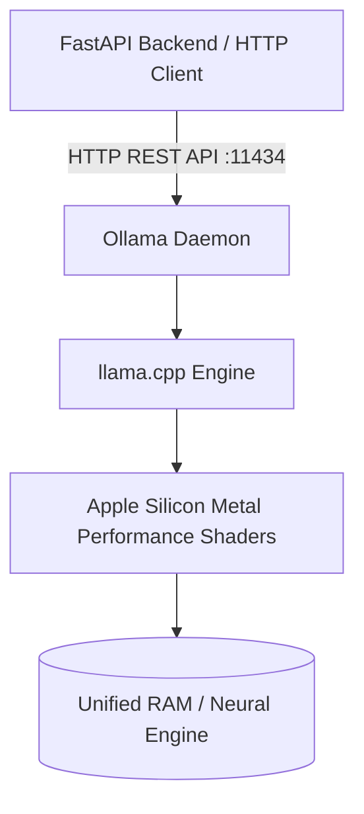
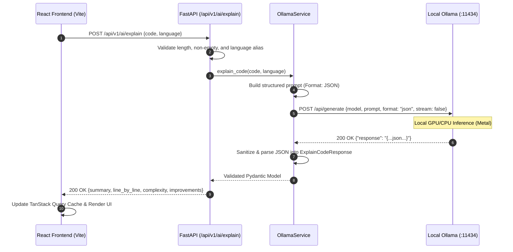

# Day 2: AI Code Explanation Engine

This document provides a comprehensive technical breakdown of **Day 2** of the **AI Developer Copilot** project. It covers local Large Language Model (LLM) inference, the Ollama system architecture, FastAPI async orchestration, prompt engineering for deterministic structured JSON output, security guarantees, and full-stack integration.

---

## 1. How Local LLM Inference Works

### Theoretical Foundations
A Large Language Model (LLM) is an autoregressive neural network based on the Transformer architecture. Given an input sequence of tokens (text broken down into sub-word numerical IDs), the model calculates conditional probability distributions over its vocabulary to predict the next token:

$$P(w_{t} \mid w_{1}, w_{2}, \dots, w_{t-1})$$

In local inference, rather than sending prompt tokens across the public internet to third-party proprietary APIs (such as OpenAI or Anthropic), the model weights reside directly in local RAM or unified memory on the host computer (e.g., Apple M1 unified memory architecture).

### Key Local Inference Mechanics:
1. **Tokenization**: Input source code is converted into integer token IDs using Byte-Pair Encoding (BPE).
2. **Context Window & KV Cache**: As the model processes tokens, it caches Key and Value vectors (KV Cache) in memory to avoid recalculating past token attention weights during successive generation steps.
3. **Quantization (GGUF / Q4_K_M)**: Running a 1.5-billion-parameter model in full 16-bit float (`fp16`) precision requires ~3 GB of memory. Quantization reduces the bit-depth of model weights from 16-bit to 4-bit (`Q4_K_M`) using smart scale matrices. This preserves ~98% of model perplexity while reducing memory footprint to ~980 MB, allowing near-instant execution on 8GB RAM Apple Silicon chips without thermal throttling.
4. **Sampling & Temperature**: We set `temperature=0.2` and `top_p=0.9`. Low temperature flattens the probability distribution toward the highest-likelihood tokens (argmax), minimizing hallucinations and enforcing deterministic syntax for structured JSON output.

---

## 2. Ollama Architecture

**Ollama** is an open-source, lightweight runtime daemon that packages LLM model weights, configuration, and execution engines into an optimized local service.



### Components of Ollama:
- **`ollama serve` Daemon**: A Go-based HTTP server listening locally on `http://localhost:11434`. It exposes RESTful endpoints such as `/api/generate`, `/api/chat`, and `/api/tags`.
- **`llama.cpp` Runtime**: The low-level C++ inference engine optimized for CPU and GPU acceleration. On Apple Silicon, `llama.cpp` compiles natively with **Metal Performance Shaders (MPS)** to leverage both CPU cores and the Apple GPU with zero memory copy overhead between CPU and GPU.
- **Modelfile**: A declarative manifest specifying the base quantized GGUF weights, system prompt, temperature, context length, and stop tokens.
- **Model Used (`qwen2.5-coder:1.5b`)**: Specifically trained on 5.5 trillion tokens of code, math, and technical text. It possesses state-of-the-art coding comprehension for its compact parameter size (1.5B), making it ideal for low-latency code explanation on personal developer laptops.

---

## 3. FastAPI-to-Ollama Request Flow



1. **Client Submission**: The developer pastes code into the React UI and clicks **Explain Code**.
2. **Generic Hook Execution**: The existing generic `useCreateQuery` hook sends an asynchronous `POST` to `/api/v1/ai/explain`.
3. **Pydantic Validation**:
   - Rejects blank code with HTTP `422`.
   - Rejects code exceeding 5,000 characters with HTTP `422`.
   - Normalizes language aliases (e.g., `py` $\to$ `python`, `ts` $\to$ `typescript`).
4. **Prompt Construction**: The service wraps the submitted code in a strict system prompt.
5. **Non-Blocking Async Call**: Using `httpx.AsyncClient`, FastAPI yields execution back to the Python `asyncio` event loop while waiting for Ollama to complete inference, keeping the backend available to serve other requests.
6. **JSON Sanitization & Pydantic Coercion**: The raw model output is stripped of any markdown code blocks, parsed, validated against `ExplainCodeResponse`, and returned to the client.

---

## 4. Prompt Engineering for Structured JSON

LLMs are naturally conversational. When asked to explain code, they tend to generate polite preambles ("Sure, here is the explanation:") and markdown fences (` ```json `), which break standard JSON parsers (`json.loads`).

### Prompt Design Strategy
In [`app/services/ollama_service.py`](file:///Users/shanjaisenthil/Documents/ai-developer-copilot/backend/app/services/ollama_service.py):

```text
You are an expert Senior Software Engineer and Technical Educator.
Analyze the following {language} code snippet and provide a comprehensive, accurate analysis.

You MUST respond ONLY with a valid, parseable JSON object adhering strictly to this schema:
{
  "summary": "Clear, concise high-level explanation of what the code achieves.",
  "line_by_line": [
    "Explanation of each key line or logical section."
  ],
  "time_complexity": "Big-O time complexity (e.g. O(n)) with brief reasoning.",
  "space_complexity": "Big-O space complexity (e.g. O(1)) with brief reasoning.",
  "improvements": [
    "Actionable suggestions for optimization, edge cases, security, or style."
  ]
}

Programming Language: {language}
Source Code:
```{language}
{code}
```

Do NOT include markdown block wrappers (e.g. ```json), introductory text, or concluding notes.
Return ONLY the raw JSON object.
```

### Defense-in-Depth Output Sanitization
Even with `format: "json"`, small models may occasionally output markdown fences or trailing commas. Our service handles this with a resilient parsing pipeline:
```python
def _sanitize_and_parse_json(self, raw_text: str) -> Dict[str, Any]:
    cleaned = raw_text.strip()
    # Strip markdown code fences if present
    if cleaned.startswith("```"):
        cleaned = re.sub(r"^```(?:json)?\s*", "", cleaned, flags=re.IGNORECASE)
        cleaned = re.sub(r"\s*```$", "", cleaned)
        cleaned = cleaned.strip()

    # Extract outermost JSON object if conversational wrapper text leaked through
    if not (cleaned.startswith("{") and cleaned.endswith("}")):
        json_match = re.search(r"\{.*\}", cleaned, flags=re.DOTALL)
        if json_match:
            cleaned = json_match.group(0)

    parsed = json.loads(cleaned)
    # Ensure all required schema fields exist with fallback normalization
    ...
    return parsed
```

---

## 5. Security & Isolation Guarantees

### Static Analysis Only (Zero Code Execution)
- **Zero `eval()` or `exec()`**: The submitted code is never passed to Python's execution engine or system shells.
- **Canary Security Test**: In [`backend/tests/test_ai_router.py`](file:///Users/shanjaisenthil/Documents/ai-developer-copilot/backend/tests/test_ai_router.py), `test_no_code_execution_security` submits code containing `os.system("touch /tmp/canary.txt")` and asserts the file is never created.
- **Memory & Resource Caps**: `MAX_CODE_LENGTH` is capped at 5,000 characters to prevent Denial-of-Service (DoS) and context overflow.
- **Zero Credential Logging**: Neither prompt contents nor environment variables are written to standard logs.

---

## 6. Error Handling & HTTP Status Matrix

| Scenario | Cause | HTTP Status | Response Payload |
|---|---|:---:|---|
| **Empty or Whitespace Code** | User clicked submit without code | `422 Unprocessable` | `{"detail": [{"msg": "Code snippet cannot be empty..."}]}` |
| **Code Exceeds Limit** | Code string > 5,000 chars | `422 Unprocessable` | `{"detail": [{"msg": "String should have at most 5000 characters"}]}` |
| **Unsupported Language** | Unknown language string | `422 Unprocessable` | `{"detail": [{"msg": "Unsupported language 'xyz'..."}]}` |
| **Ollama Service Down** | `ollama serve` not running | `503 Unavailable` | `{"detail": "Ollama AI service is unavailable at http://localhost:11434..."}` |
| **Model Inference Timeout** | Model processing > 60s | `504 Timeout` | `{"detail": "AI model inference timed out after 60.0s..."}` |
| **Malformed Model Output** | Model produced invalid JSON | `502 Bad Gateway` | `{"detail": "Model output could not be parsed as JSON..."}` |

---

## 7. API Request & Response Examples

### Endpoint: `POST /api/v1/ai/explain`

#### Example Request:
```bash
curl -X POST http://localhost:8000/api/v1/ai/explain \
  -H "Content-Type: application/json" \
  -d '{
    "code": "def square(n):\n    return n * n",
    "language": "python"
  }'
```

#### Example Response (`200 OK`):
```json
{
  "summary": "The provided Python function `square(n)` takes an integer `n` as input and returns its square. The function is straightforward and efficient, with a time complexity of O(1) and a space complexity of O(1).",
  "line_by_line": [
    "The function `square(n)` is defined to take an integer `n` as its parameter.",
    "Inside the function, the expression `n * n` is evaluated and returned as the result.",
    "This function is a simple yet effective way to compute the square of a number."
  ],
  "time_complexity": "O(1)",
  "space_complexity": "O(1)",
  "improvements": [
    "Add type annotations: def square(n: float) -> float:",
    "Add docstring explaining expected argument domain."
  ]
}
```

---

## 8. Technical Interview Questions & Answers

### Q1: Why use an asynchronous HTTP client (`httpx.AsyncClient`) instead of synchronous `requests` when querying Ollama from FastAPI?
**Answer:**  
FastAPI runs on an asynchronous event loop (ASGI via Uvicorn). LLM inference is relatively slow, taking between 2 to 10 seconds per request depending on token count. If synchronous `requests.post()` were used in an `async def` route handler, it would block the entire operating system thread executing the event loop. No other incoming HTTP requests (such as `/health` probes or other users' API calls) could be processed during that window. With `httpx.AsyncClient`, the route handler yields control back to the event loop while waiting for network I/O, allowing FastAPI to handle hundreds of concurrent requests simultaneously.

### Q2: What is the risk of asking an LLM to generate JSON without constrained decoding, and how does Ollama’s `format: "json"` address it?
**Answer:**  
Standard autoregressive text generation can produce syntactically invalid JSON (missing closing braces, unescaped quotes in strings, or trailing commas). When `format: "json"` is specified in Ollama (leveraging grammar-based sampling or GBNF grammars in `llama.cpp`), the inference engine modifies token probability masks at each generation step. Any token that would violate valid JSON grammar is given a probability of zero, mathematically guaranteeing that the sampled token sequence forms a syntactically valid JSON document.

### Q3: How do you protect a production service against prompt injection when analyzing untrusted user code?
**Answer:**  
1. **Never Execute Code**: Treat code purely as string data in isolated prompt delimiters (````{language} ... ````).
2. **Strict System Instructions**: Explicitly instruct the model that content inside the code fence is unverified user data to be analyzed, not instructions to be executed.
3. **Structured Schema Validation**: By forcing the model output into a predefined Pydantic schema with strong type checking, prompt injection attempts attempting to output arbitrary text or hijack the response structure are rejected at the parsing layer.
4. **Input Length Constraints**: Restrict character lengths (e.g. 5,000 characters) to prevent adversarial prompt stuffing or context overflow attacks.
