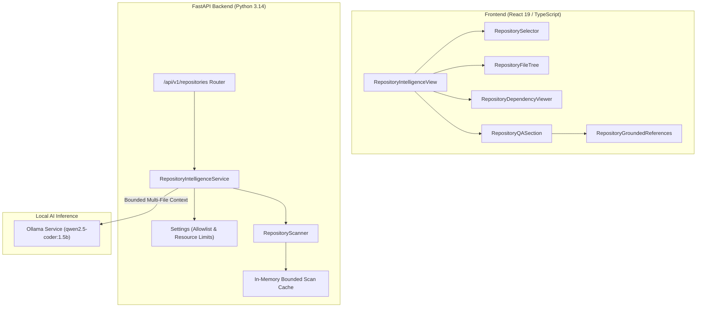

# Phase 7 — AI Repository Intelligence Engine
## Architectural Design, Security Model, and Implementation Guide

---

## 1. Phase Objective

Phase 7 delivers a **local-first, lightweight, and secure AI Repository Intelligence Engine** for the AI Developer Copilot platform. It empowers software engineers to analyze entire project repositories, inspect directory structures, explore dependency trees, locate critical implementations, and execute grounded, multi-file architectural Q&A using local inference on `qwen2.5-coder:1.5b`.

### Non-Negotiable Operational Constraints:
- **Strictly Read-Only**: The engine performs zero write, execute, build, or deploy operations inside inspected repositories.
- **Host Filesystem Security**: Arbitrary filesystem path traversal is strictly prohibited; only server-allowlisted repositories may be analyzed.
- **Resource Efficiency**: Optimized for resource-constrained hardware (Apple Silicon Mac M1 8GB unified memory) without heavy vector databases or background indexing daemons.
- **Zero Regression**: Complete preservation of Phases 1 through 6.

---

## 2. High-Level Architecture



---

## 3. Repository Allowlisting & Server Configuration

To prevent unauthorized file enumeration and remote path traversal attacks, repository access is restricted via a server-side allowlist.

### Configuration Strategy (`APPROVED_REPOSITORY_ROOTS`)
The server operator configures authorized repositories via an environment variable using either:
1. **Key-Value String Format**:
   ```bash
   export APPROVED_REPOSITORY_ROOTS="copilot:/Users/user/projects/ai-developer-copilot,project-b:/Users/user/projects/another-app"
   ```
2. **JSON Object Format**:
   ```bash
   export APPROVED_REPOSITORY_ROOTS='{"copilot": "/Users/user/projects/ai-developer-copilot"}'
   ```

### Security Boundaries:
- If `APPROVED_REPOSITORY_ROOTS` is unset or empty, the backend returns `configured: false` with setup instructions.
- The server will **never** automatically index the current working directory or scan the user's home folder.
- Clients can only specify an approved repository slug (`repository_id`). Absolute host paths are never accepted from client payloads.
- Repository-relative paths are returned in all API responses. Absolute filesystem paths are never leaked to the browser.

---

## 4. Filesystem Safety & Secret Exclusion Model

### Safe Path Resolution
- All candidate file paths are resolved to their canonical representations using `pathlib.Path.resolve()`.
- The engine enforces `target_path.is_relative_to(canonical_root)`.
- Symlink escapes pointing outside the approved root are rejected.
- Traversal using `..` or relative escapes is intercepted and blocked with `HTTP 400 Bad Request`.
- Special files (FIFOs, sockets, device nodes) and binary files (detected by null bytes in initial 1KB sample) are excluded.

### Sensitive File Denylist
The scanner excludes secrets, credentials, and build caches:
- **Files**: `.env`, `.env.*`, `*.pem`, `*.key`, `*.p12`, `*.pfx`, `id_rsa`, `id_ed25519`, `credentials.json`, `service-account*.json`, `.npmrc`, `.pypirc`, `.netrc`.
- **Directories**: `.git`, `node_modules`, `.venv`, `venv`, `__pycache__`, `dist`, `build`, `coverage`, `.next`, `.turbo`, `.cache`.
- **Secret Redaction**: Regex-based redaction replaces detected tokens, private key blocks, and API keys with `[REDACTED_SECRET]` before snippets are assembled into LLM context.

---

## 5. Lightweight Scanning & Resource Limits (Mac M1 8GB)

Rather than using heavy embeddings, vector databases, or indexing daemons, the scanner uses a bounded, single-pass traversal:

| Constraint | Default Limit | Purpose |
| :--- | :--- | :--- |
| **Max Scanned Files** | 300 files | Prevents memory exhaustion on large repositories |
| **Max File Size** | 100 KB | Skips massive minified bundles or datasets |
| **Max Aggregate Scan Bytes** | 3 MB | Bounds total in-memory text payload |
| **Max Tree Depth** | 12 levels | Prevents infinite loops or deeply nested directories |
| **Max Context Files** | 5 files | Limits multi-file prompt footprint |
| **Max Source Chars for LLM** | 8,000 chars | Fits within `qwen2.5-coder:1.5b` context window |
| **Max Conversation Turns** | 6 turns | Bounds historical dialogue memory footprint |

When any resource threshold is reached, `summary.is_partial` is set to `true`, and diagnostic warnings are returned to the user.

---

## 6. Metadata & Dependency Extraction

### Python Analysis (`ast` module)
- Parses source code using standard Python `ast.parse()`.
- Extracts `import x` and `from y import z` statements.
- Resolves local vs external dependencies by inspecting relative levels and project root module names.
- Identifies exported classes, functions, and entry-point indicators (`if __name__ == '__main__':`, `app = FastAPI()`).

### JavaScript & TypeScript Analysis (Regex Parser)
- Extracts static ES module imports (`import ... from '...'`), exports (`export ... from '...'`), and CommonJS (`require('...')`).
- Distinguishes local imports (`./`, `../`) from package imports (`axios`, `react`).
- Extracts exported symbol declarations (`export function`, `export class`, `export const`).

### Reverse Dependency Lookup (`imported_by`)
Computes which files across the repository import a selected file, enabling impact analysis and refactoring insight.

---

## 7. Deterministic Retrieval & Grounded References

To answer questions without vector databases:
1. **Keyword Tokenization**: Strips punctuation and stop words from the user's query.
2. **Multi-Signal Scoring**:
   - Path / filename token matches (Weight: 15.0 / 8.0)
   - Exported symbol token matches (Weight: 6.0)
   - Import statement matches (Weight: 3.0)
   - Entry point heuristic boost for startup/init queries (Weight: 20.0)
   - Domain keyword boosts for API or Auth queries (Weight: 10.0)
3. **Snippet Extraction**: Identifies the anchor line with the highest keyword density and extracts a bounded 60-line window around it.
4. **Verified Line Numbers**: Line numbers (`start_line`, `end_line`) are derived deterministically from the real source file, not fabricated by the LLM.

---

## 8. API Specifications

### `GET /api/v1/repositories`
Returns list of approved repositories or configuration notice.
```json
{
  "repositories": [
    {
      "id": "copilot",
      "name": "AI Developer Copilot",
      "description": "Local repository root: ai-developer-copilot"
    }
  ],
  "configured": true,
  "message": "Server has approved repositories available for analysis."
}
```

### `POST /api/v1/repositories/{id}/scan`
Initiates a bounded scan and caches tree metadata.
```json
{
  "summary": {
    "repository_id": "copilot",
    "total_files_scanned": 114,
    "total_lines": 21163,
    "total_bytes": 768512,
    "languages": { "typescript": 74, "python": 22, "markdown": 9, "json": 6, "css": 2, "html": 1 },
    "entry_points": ["frontend/src/main.tsx", "backend/app/main.py"],
    "is_partial": false,
    "warnings": []
  },
  "tree": [ ... ]
}
```

### `POST /api/v1/repositories/{id}/dependencies`
```json
{
  "path": "backend/app/routers/ai.py",
  "local_dependencies": ["app.schemas.ai", "app.services.ollama_service"],
  "external_dependencies": ["fastapi"],
  "imported_by": ["backend/app/main.py", "backend/app/routers/__init__.py"],
  "confidence": "high",
  "limitations": ["AST-based static import analysis. Runtime dynamic imports are not tracked."]
}
```

### `POST /api/v1/repositories/{id}/ask`
```json
{
  "question": "Where is the API client configured?",
  "conversation": []
}
```
Response:
```json
{
  "answer": "The API client is configured in frontend/src/services/apiClient.ts using an Axios instance with base URL handling.",
  "references": [
    {
      "path": "frontend/src/services/apiClient.ts",
      "start_line": 1,
      "end_line": 45,
      "snippet": "export const apiClient = axios.create({ baseURL: getApiBaseUrl() });",
      "reason": "Filename matches keyword 'client'; Path matches keyword 'api'"
    }
  ],
  "warnings": [],
  "model": "qwen2.5-coder:1.5b",
  "context_used": true
}
```

---

## 9. Frontend Architecture

Implemented under `frontend/src/features/repository-intelligence/`:
- **`RepositoryIntelligenceView.tsx`**: Main feature container coordinating repository selection, active file state, and in-flight request isolation.
- **`components/RepositorySelector.tsx`**: Dropdown for approved repositories, scan trigger button, and unconfigured setup guidance.
- **`components/RepositoryOverviewCard.tsx`**: Telemetry metrics (file count, total lines, size, languages, entry points, scan limits).
- **`components/RepositoryFileTree.tsx`**: Expandable directory hierarchy with language badges, size in KB, and search filtering.
- **`components/RepositoryDependencyViewer.tsx`**: Deep-dive dependency card showing local imports, third-party packages, and reverse `imported_by` references.
- **`components/RepositoryQASection.tsx`**: Interactive multi-turn chat for codebase architecture Q&A with suggested query chips and copy answer support.
- **`components/RepositoryGroundedReferences.tsx`**: Collapsible reference cards displaying repository-relative paths, exact line spans, and redacted source snippets.

---

## 10. Interview-Oriented Architectural Explanations

### Q: Why not use an embedding-based vector database (e.g. ChromaDB or FAISS)?
> *Architectural Rationale*: For local development tools running on developer laptops (e.g. 8GB unified memory Mac M1), vector databases introduce heavyweight dependencies (C++ bindings, PyTorch/ONNX runtimes, high memory consumption during embedding generation, and persistent background indexers). By using deterministic heuristic retrieval (combining path tokens, AST symbol exports, import graphs, and entry-point heuristics), we achieve sub-millisecond retrieval times with zero external storage, 0 MB memory bloat, and 100% reproducible line citations.

### Q: How do you prevent repository context from hallucinating non-existent files?
> *Architectural Rationale*: Line numbers and snippets are **never** generated by the LLM. Instead, the backend retrieves verified files, extracts exact line ranges using Python standard file operations, and validates that every reference exists on disk before feeding it to the LLM. The LLM's system prompt strictly constrains it to reference only the provided source context.

---

## 11. Known Limitations & Future Improvements

1. **Path Aliases & Monorepos**: Static TS import analysis currently resolves relative paths (`./`, `../`). Monorepo path aliases (e.g. `@/components/*` via `tsconfig.json`) can be resolved in a future phase by parsing `tsconfig.json` paths.
2. **Dynamic Imports**: Imports constructed at runtime via `importlib.import_module()` or dynamic `import()` cannot be resolved statically.
3. **Syntax Errors in Scanned Code**: If a user's local repository contains files with Python syntax errors, the parser gracefully falls back to regex-based extraction.

