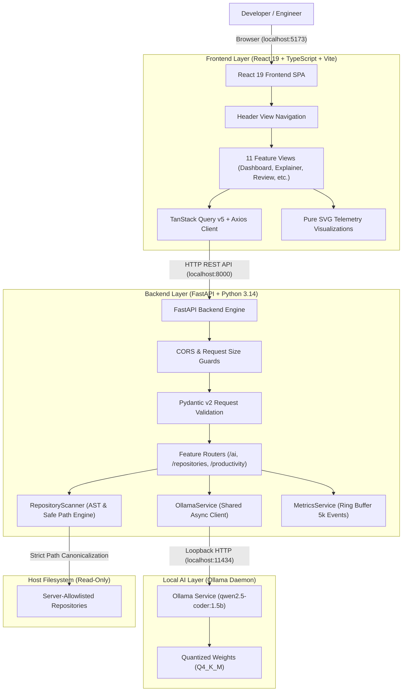
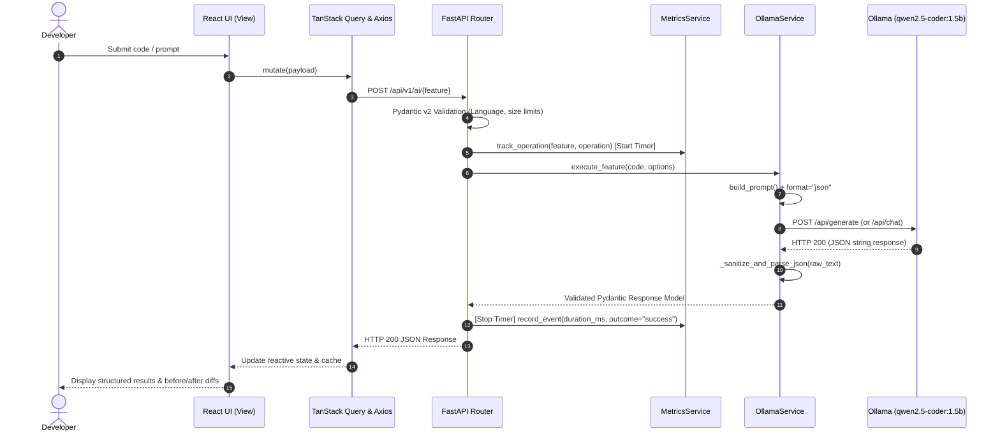

# AI Developer Copilot — System Architecture & Design Specification

## 1. System Overview

**AI Developer Copilot** is a local-first, privacy-preserving developer assistant and codebase intelligence platform. The architecture is engineered to run completely offline on Apple Silicon (Mac M1, 8GB unified memory) using local Large Language Model inference (`qwen2.5-coder:1.5b` via Ollama) with zero cloud dependencies.



---

## 2. Request Lifecycle & End-to-End Sequence



---

## 3. Frontend Architecture

### 3.1. Component Hierarchy
- `App.tsx`: Root application container with TanStack `QueryClientProvider`.
- `DashboardView.tsx`: Main application shell managing `activeView` state and mounting isolated feature views.
- `Header.tsx`: Brand section with Phase 12 indicator, connection status pill, refresh trigger, and 11-tab view switcher.
- **Feature Modules**:
  1. `features/dashboard/`: System telemetry, diagnostics, and API contract verifier.
  2. `features/code-explainer/`: Code explanation, line-by-line logic breakdown, and Big-O complexity estimates.
  3. `features/code-review/`: Static flaw inspection, bug detection, severity pills, and copyable improved code.
  4. `features/code-optimizer/`: Algorithmic and architectural code optimization with goal selectors.
  5. `features/test-generator/`: Automated unit test generation (`pytest` and `vitest`).
  6. `features/ai-chat/`: Multi-turn conversational pair programmer with pinned code context.
  7. `features/repository-intelligence/`: Repository tree browser, AST dependency viewer, and grounded Q&A.
  8. `features/debugging/`: Stack trace analyzer, root-cause hypothesis cards, and suggested fixes.
  9. `features/refactoring/`: Code smell detection and unified before/after diff viewers.
  10. `features/documentation/`: Technical documentation generator (READMEs, API docs, architecture summaries).
  11. `features/productivity/`: Real-time KPI cards, feature distribution bar charts, latency trendline graphs, and activity logs.

### 3.2. State Isolation & Cache Strategy
- **Cross-Feature Isolation**: Unmounting views on tab switch releases memory and prevents cross-tool state leakage.
- **TanStack Query Caching**: Stale times configured between 5s (metrics/summary) and 60s (welcome/health) to eliminate duplicate network calls while maintaining real-time responsiveness.
- **Zero-Dependency SVG Visualizations**: All charts in the Productivity Dashboard are implemented using raw SVG elements (`<svg>`, `<rect>`, `<polyline>`, `<circle>`), eliminating heavy chart dependencies and keeping the total client bundle under 550 kB.

---

## 4. Backend Architecture

### 4.1. Modular Design
- `app/main.py`: FastAPI application entry point, CORS middleware, global health probe.
- `app/core/config.py`: Centralized environment configuration and safety limits.
- `app/schemas/`: Pydantic v2 schemas for strict contract validation:
  - `ai.py`: Explain, Review, Optimize, Generate Tests, Chat schemas.
  - `repository.py`: Tree nodes, metadata, dependencies, Q&A schemas.
  - `debugging.py`: Stack trace frames, root-cause hypotheses, suggested fixes.
  - `refactoring.py`: Code smells, refactoring suggestions, diffs.
  - `documentation.py`: Documentation modes, verified facts, assumptions.
  - `productivity.py`: Metrics summary, feature metrics, timeline points, health.
- `app/services/`: Asynchronous business logic and AI engines:
  - `ollama_service.py`: Shared client, connection pooling, JSON fence sanitization, health checks.
  - `repository_scanner.py`: Canonical path resolution, secret exclusion, Python AST parsing, tree building.
  - `repository_intelligence.py`: Multi-file relevance scoring, context window truncation, grounded Q&A.
  - `debugging_service.py`: Stack trace regex parsing, repository context retrieval, fix generation.
  - `refactoring_service.py`: Static code smell heuristics, unified diff generation, cross-file impact.
  - `documentation_service.py`: Static extraction and documentation synthesis.
  - `metrics_service.py`: Thread-safe in-memory ring buffer (`maxlen=5000`), percentile math, time filtering.

---

## 5. Security Architecture & Threat Model

| Threat / Risk | Defense Mechanism | Implementation |
|---|---|---|
| **Path Traversal Attacks** | Canonical resolution via `pathlib.Path.resolve()`. | `is_path_safe(root, target)` verifies that resolved canonical paths are children of the approved repository root. Rejects `../` and absolute paths. |
| **Symlink Escapes** | Symlinks pointing outside the repository root are ignored. | `RepositoryScanner._scan_directory()` validates symlink targets before traversal; out-of-root links are discarded. |
| **Secret File Leakage** | Explicit pattern and filename exclusion. | Excludes `.env*`, `*.pem`, `*.key`, `id_rsa*`, `credentials.json`, `*.sqlite`, and service account tokens. |
| **Prompt Injection** | Strict delimiter boundaries and untrusted data wrapping. | User input and repository files are enclosed in explicit markdown fences with system instructions prohibiting command execution. |
| **Arbitrary Code Execution** | Pure static analysis and synthesis; zero execution. | No `eval()`, `exec()`, or `subprocess` execution of user or model-generated code. |
| **Telemetry Privacy Leakage** | Strict metadata-only ring buffer. | Telemetry records only `duration_ms`, `outcome`, `feature`, and `model`. Prompts, code snippets, tokens, and keys are barred. |
| **Denial of Service (DoS)** | Enforced request character bounds and scan limits. | Input length capped at 5,000–8,000 characters; repository scanning capped at 300 files and 3 MB aggregate bytes. |

---

## 6. Local Ollama Integration Details

- **Model**: `qwen2.5-coder:1.5b` (Q4_K_M quantization).
- **Inference Parameter Tuning**:
  - `temperature: 0.2` (Deterministic, reproducible code generation).
  - `top_p: 0.9` (Focused sampling).
  - `repeat_penalty: 1.1` (Prevents degenerative infinite code loops).
- **JSON Sanitization Engine (`_sanitize_and_parse_json`)**:
  - Automatically strips markdown fences (````json ... ````).
  - Uses regex fallback extraction (`\{.*\}`) if the LLM surrounds JSON with conversational prose.
- **Resilience & Timeout Handling**:
  - Connect error: Maps to HTTP 503 Service Unavailable.
  - Timeout (60s): Maps to HTTP 504 Gateway Timeout.
  - Malformed payload: Maps to HTTP 502 Bad Gateway with fallback parsing.

---

## 7. Performance & Resource Optimization (Mac M1, 8GB RAM)

- **Memory Footprint**:
  - Ollama with `qwen2.5-coder:1.5b`: ~1.1 GB unified memory during active inference.
  - FastAPI backend: ~45–65 MB RSS memory.
  - In-memory metrics ring buffer: ~1.8 MB for 5,000 capacity events.
  - React frontend (Vite production build): 533 kB client bundle (139 kB gzip).
- **Sub-10ms Analytics**:
  - Ingestion throughput: ~192,500 operations/second.
  - Full ring-buffer KPI summary calculation: ~1.02 ms.
  - Feature distribution breakdown: ~1.38 ms.
  - Timeline bucketing: ~9.45 ms.
- **Concurrency & Resource Protection**:
  - Context window character budget enforced (max 8,000 chars context) to prevent memory pressure or swap thrashing.

